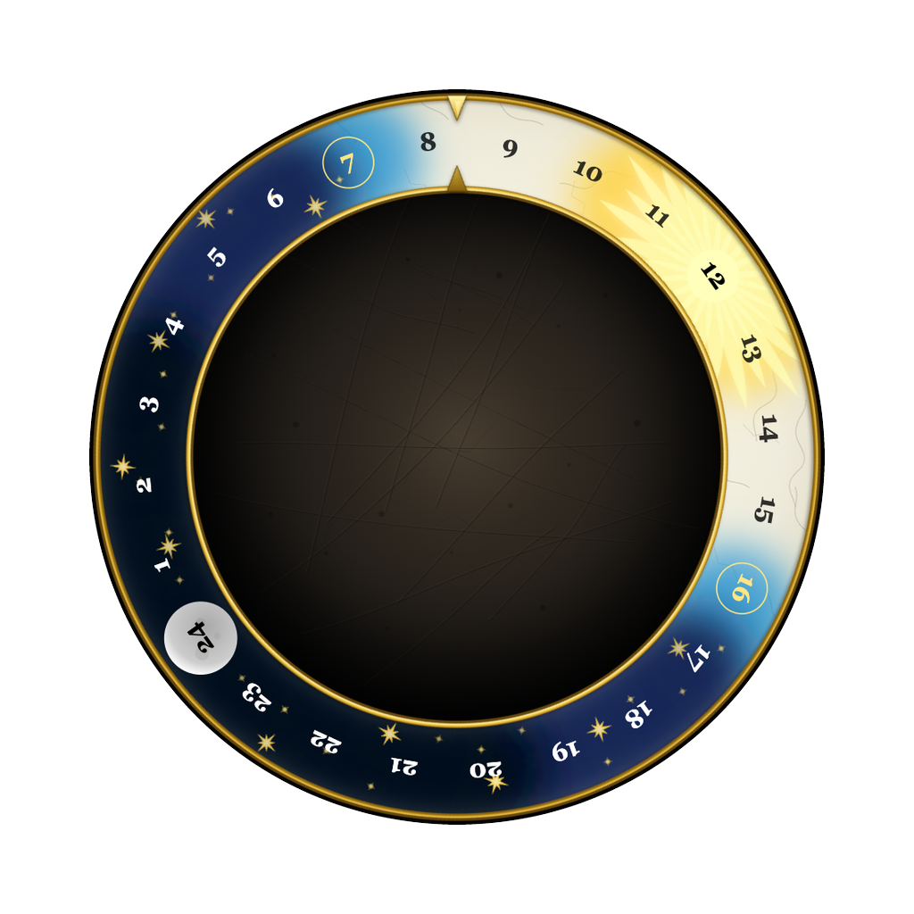

<p align="center">
  
</p>

<h1 align="center">Bohemian Day Clock</h1>

<p align="center">
  Your whole day on one turning dial: daylight, night, sunrise and sunset for your city.
</p>

<p align="center">
  <a href="https://bohemian-day-clock.vercel.app"><b>Open in your browser</b></a> ·
  <a href="https://github.com/carbongo/bohemian-day-clock/releases/latest"><b>Download for macOS, Windows, Linux</b></a> ·
  <a href="#install"><b>Homebrew</b></a>
</p>

<p align="center">
  <a href="https://github.com/carbongo/bohemian-day-clock/releases/latest"></a>
  <a href="https://github.com/carbongo/bohemian-day-clock/actions/workflows/ci.yml"></a>
  <a href="LICENSE"></a>
</p>


## Why

A normal clock tells you the time. This one shows where you are in the day: how much light is left, when the sun went up, when it goes down. The ring turns once every 24 hours under a fixed pointer, like an old astronomical clock.

## Features

- **24-hour dial** that turns once a day under a fixed pointer.
- **Real daylight** for the chosen city: sunrise and sunset are calculated, not looked up, and the ring paints day and night to match. Polar day and polar night included.
- **Your city by default**, picked from your timezone; choose another in Settings (`S`). The choice is remembered.
- **Hand-drawn in SVG**: every ring, star and glow is code, so it is sharp at any size.
- **Works offline**: one self-contained HTML file, no server, no tracking, no network calls.
- **Desktop apps** for macOS (universal), Windows and Linux, around 10 MB each.

## Install

| Platform | How                                                                                                                                                   |
| -------- | ----------------------------------------------------------------------------------------------------------------------------------------------------- |
| Browser  | [bohemian-day-clock.vercel.app](https://bohemian-day-clock.vercel.app), or download `…_web.html` from a release and open it.                          |
| macOS    | `brew install --cask carbongo/tap/bohemian-day-clock`, or the `.dmg` from [Releases](https://github.com/carbongo/bohemian-day-clock/releases/latest). |
| Windows  | `.msi` from [Releases](https://github.com/carbongo/bohemian-day-clock/releases/latest).                                                               |
| Linux    | `.deb` or `.AppImage` from [Releases](https://github.com/carbongo/bohemian-day-clock/releases/latest).                                                |

The macOS app is not notarised. Homebrew handles that; with the `.dmg`, open the app once, then allow it in System Settings → Privacy & Security → **Open Anyway**.

## Keyboard

| Key | Action      |
| --- | ----------- |
| `S` | Settings    |
| `G` | GitHub page |

## Build from source

Needs Node.js 22+.

```sh
npm install
npm run start       # dev server on http://localhost:8000
npm run build       # public/index.html, one self-contained file
npm run desktop     # desktop app for this OS (needs Rust), into release/
```

How it is put together: [docs/architecture.md](docs/architecture.md). Packaging and releases: [docs/desktop.md](docs/desktop.md).

## Contributing

Issues and pull requests are welcome. Keep changes focused, keep the build a single file, and run `npm run typecheck` and `npm run build` before opening a PR.

## Disclaimer

An unofficial fan project, loosely inspired by the medieval clock in Kingdom Come: Deliverance. All artwork is original React/SVG; it contains no game assets, logos, fonts or screenshots. Not affiliated with or endorsed by Warhorse Studios; Kingdom Come: Deliverance and Warhorse Studios are trademarks of their respective owners.

## Licence

[ISC](LICENSE) © Georgii Antipin
